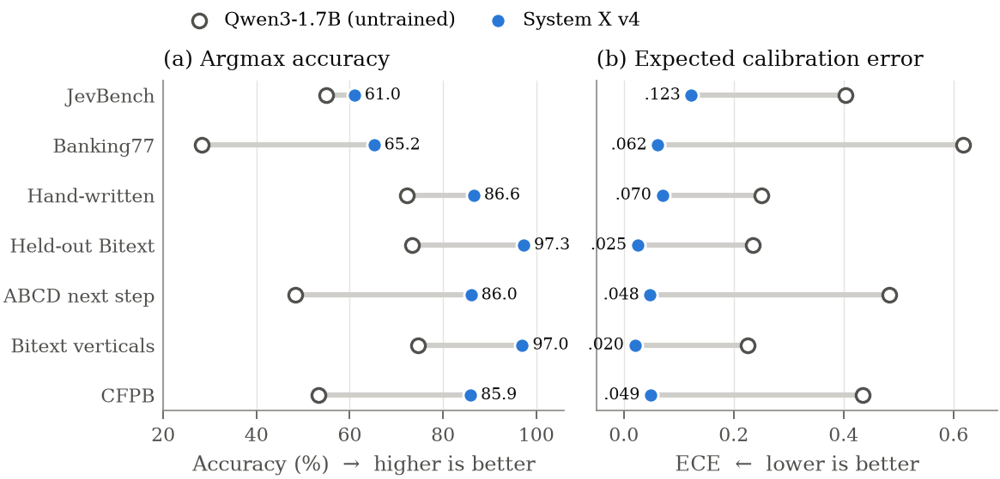
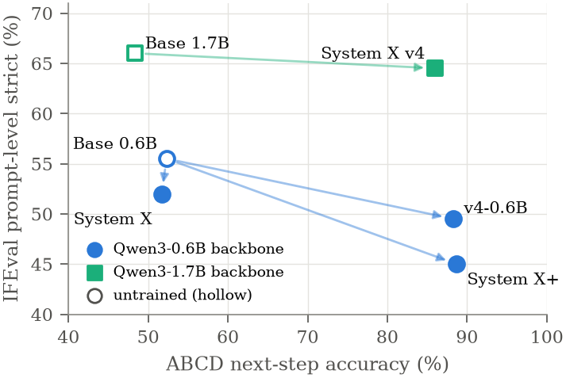
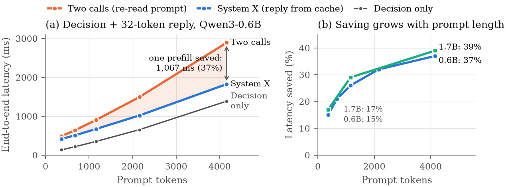
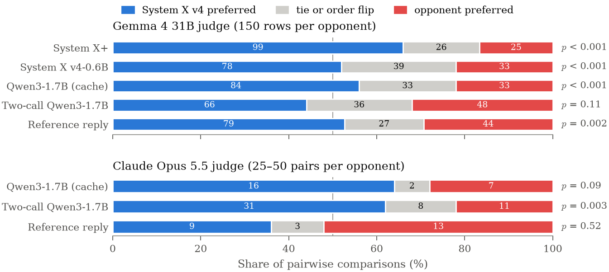

# System X: An LLM Decision Model That Replies from Its Own KV Cache

**Authors:** Dr. Syed Usama Khalid Bukhari (Turing Logic LTD), Dr. Syed Safwan Khalid (Idrak AI LTD), Dr. Muhammad Aamir (University of Oxford)

<!--**Paper:** [`paper/main.pdf`](paper/main.pdf) (arXiv link to follow)-->

## What it is

System X is a small LLM decision model for customer-support agents.
- **Deciding:** give it a situation (the *State*) and a numbered list of options, and it returns a calibrated probability for every option in a single prefill, following the LLM-as-Jev readout.
- **Replying:** one option is special: `REPLY_WITH_TEXT`. When that option wins, or no option is confident enough, the **same model continues from the key–value (KV) cache it already built for the decision** and writes a one- to two-sentence reply.
- **No second call:** the prompt is never processed twice.

```
State + options ──► 1 prefill + batched suffix scoring ──► P([1]) P([2]) P([3]) ...
                                                             │
          action wins, confident ────────────────────────────┴──► return the decision
          REPLY wins / low confidence ───────────────────────────► continue from the decision's KV cache,
                                                                   write a 1–2 sentence reply
```

**The architecture is unchanged:** the standard Qwen3 transformer and tokenizer plus a LoRA adapter. The contribution is in the prompt, the readout, the decoding procedure and the training objective (the LLM-as-Jev tree-factorized listwise loss with KL anchors, plus reply language-model, reply-KL and Brier terms).

## Main results

**System X v4** (Qwen3-1.7B, LoRA) against its untrained base model:

| | Qwen3-1.7B (untrained) | System X v4 |
|---|---|---|
| JevBench public (231 items, FP32) | 55.0% (ECE 0.404) | **61.0%** (ECE 0.123), p = 0.04 |
| Banking77 (77 options) | 28.3% | **65.2%** |
| Hand-written support cases (97) | 72.2% | **86.6%** |
| ABCD next-step decisions (held out) | 48.3% | **86.0%** |
| IFEval (prompt-level strict) | 66.0% | 64.5% (not significant, p = 0.71) |



The 0.6B models traded instruction following for support-task accuracy; at 1.7B, v4 keeps the support gains without a significant IFEval change:

<p align="center"></p>

**Latency:** replying from the decision's cache saves **17–39%** of end-to-end latency at 1.7B (367 to 4,161 prompt tokens), and 15–37% at 0.6B. In FP32 the cached reply is token-for-token identical to a full re-read.



**Reply quality:** of two LLM judges, one (Claude Opus 5.5) prefers v4's replies to a separate, unadapted Qwen3-1.7B reply call (31 to 11 pairs, p = 0.003). The other (Gemma 4 31B) shows no significant preference (66 to 48 pairs, p = 0.11). These comparisons also differ in prompts and training.



**Remaining failure modes:** decisions that contradict account state (e.g. an address change on a shipped order), and occasional invented placeholder phone numbers.

All configurations (System X, System X+, System X v4 and a 0.6B control), every statistical test and all caveats are in the paper.

## Quick start

```bash
uv sync                                    # Python 3.12, torch, transformers, peft, pandas
```

```python
from tl_decision_plus.engine import DecisionEngine
from tl_decision_plus.options import make_options

eng = DecisionEngine(adapter_path="out/v4")          # the base model is read from the adapter
opts = make_options(["AUTO_REFUND", "BLOCK_FRAUD", "ESCALATE_HUMAN", "REPLY_WITH_TEXT"])
r = eng.decide({"customer_msg": "Why is my bill $14 this month instead of $10?",
                "invoice_note": "$4 add-on: extra storage"}, opts, threshold=0.65)
print(r["decision"], r["probability"], r["text"])  # text is None unless the model replied
```

A local web console is also included: `uv run server.py --adapter out/v4`, then open http://127.0.0.1:8777.

## Reproducing the paper

| Step | Command |
|---|---|
| System X data (v2) | `uv run data/prepare_v2.py` |
| System X+ data (v3) | `uv run data/prepare_v3.py` (needs the ABCD files from github.com/asappresearch/abcd in `data/raw_v3/`) |
| System X v4 data | `uv run data/prepare_v4.py --teacher-url <ollama-host>/api/chat` (teacher: `qwen3:14b`) |
| Training | `uv run train_v2.py --base Qwen/Qwen3-1.7B --train data/v4/train.jsonl --out out/v4 --ref out/v4_ref.pt --token-budget 16000` |
| Decisions | `bench.py` (JevBench, Banking77), `eval_v2.py` (reply task and held-out support sets) |
| Replies | `reply_checks.py`, `abcd_rank.py`, `reply_gen.py`, `judge.py`, `judge_report.py`, `judge_agreement.py` |
| Latency | `latency.py` |

Every script prints its usage at the top of the file. The development log for v0.1 to v0.4 is in [`docs/DEVELOPMENT_LOG.md`](docs/DEVELOPMENT_LOG.md).

## Code layout

| Path | Contents |
|---|---|
| `tl_decision_plus/` | The prompt format, suffix scoring from one prefill, and `DecisionEngine` (decision plus reply from the same cache) |
| `data/` | Dataset builders, and the 97 hand-written test cases |
| `train_v2.py` | Training: listwise loss, KL anchors, Brier, reply LM and KL |
| `paper/` | LaTeX source and PDF |
| `docs/figures/` | README figures; regenerate with `python paper_v2/figures/make_figures.py --png docs/figures hf/figures` |
| `web/`, `server.py`, `rate_server.py` | Local decision console and a blind A/B rating page |

## Model weights

The trained System X v4 LoRA adapter is on Hugging Face at **[TuringLogic/system-x](https://huggingface.co/TuringLogic/system-x)** under **CC BY-NC 4.0**. The base Qwen3 models (Apache-2.0) are not redistributed.

## License

The code in this repository is licensed under **[CC BY-NC 4.0](LICENSE)**: you may use and adapt it with attribution, for **non-commercial purposes only**. For commercial licensing, contact Turing Logic LTD.

Training data keeps its own licences (see the paper's appendix). ReClor is research-only and LogiQA 2.0 is CC BY-NC-SA 4.0.

## Acknowledgements

This work builds on the LLM-as-Jev prompt, readout, objective and data recipe (Li & Wagle, arXiv:2610.02076). It uses Qwen3 models by the Qwen team, and public datasets including Bitext, ABCD, CFPB, CLINC150, MASSIVE, ReClor, LogiQA 2.0, CosmosQA, PIQA, αNLI, ProofWriter, Banking77 and JevBench. It is not affiliated with TypeSafe AI.

## Citation

```bibtex
@misc{bukhari2026systemx,
  title  = {System X: An LLM Decision Model That Replies from Its Own KV Cache},
  author = {Bukhari, Syed Usama Khalid and Khalid, Syed Safwan},
  year   = {2026},
  note   = {Turing Logic LTD; code at https://github.com/Turinglogicuk/system-x}
}
```
